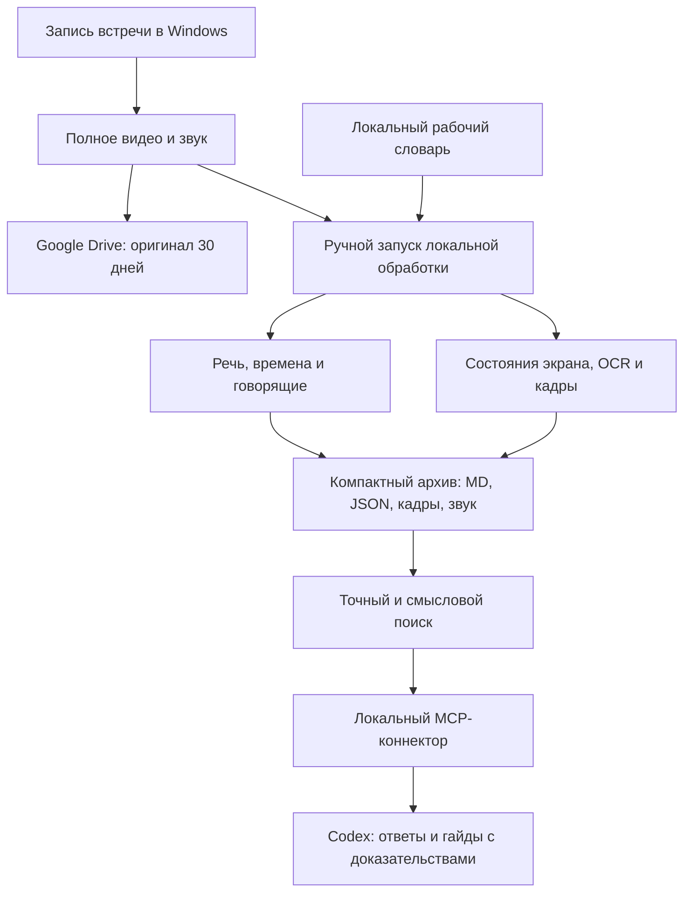

# Итоговая архитектура: локальный архив рабочих встреч

Версия 1.0 · 14 ноября 2026 года.

Это итоговая архитектура по согласованным требованиям. Документ описывает целевой продукт и план его проверки. Новые функции пока не реализованы; исходный Video-Transcribe уже предоставляет аудиораспознавание и часть инфраструктуры. Изменены только документы.

## 1. Решение

Развить Video-Transcribe в единое Windows-приложение для офисного сотрудника. Оно записывает браузерные встречи, по команде пользователя локально готовит компактный архив, а затем предоставляет Codex прямой доступ к поиску, речи, кадрам и рабочим терминам через MCP.

Долговременная единица хранения — переносимая папка встречи с Markdown, структурированными данными, выбранными кадрами и сжатым звуком. Полное видео хранится в Google Drive первые 30 дней. Компактный архив и словарь сохраняются не меньше шести месяцев.

После первоначальной подготовки локальные этапы не требуют внешнего LLM API. Внешняя модель используется, когда пользователь задаёт вопрос: Codex получает выбранные текстовые фрагменты и изображения. Drive используется для хранения и резервирования, а не для распознавания. Gemini остаётся необязательным дополнительным ресурсом.

## 2. Границы первой версии

| Параметр | Решение |
|---|---|
| Пользователь | Офисный сотрудник без навыков программирования |
| Платформа | Windows x64, сильный CPU и встроенная графика; обязательной NVIDIA нет |
| Встречи | Новые встречи в meet.egovm.ru/Jitsi, преимущественно Jira, DBeaver и рабочие чаты |
| Нагрузка | 2–6 встреч в день, 30–120 минут каждая |
| Запись | Начало и завершение вручную |
| Обработка | Отдельный ручной запуск одной встречи или выбранной очереди |
| Имена | Пользователь связывает найденные голоса с людьми по коротким образцам |
| Доступ агента | Здесь, в Codex; без ручного прикладывания видео и копирования текста |
| Результат | Подробный проверяемый черновик; пробелы и неопределённость обозначаются |
| Производительность | Цель — не более часа подготовки на час записи; проверяется на пилоте |
| Бюджет | До 1000 рублей дополнительных регулярных расходов в месяц, без уже оплаченных подписок |
| Хранение | Компактный архив от шести месяцев; оригиналы видео в Drive 30 дней |

Первая версия не требует импорта старого массива встреч, командного многопользовательского сервера или графовой базы знаний. Перенос архива между компьютерами входит в проект; одновременная запись одной живой БД с нескольких компьютеров — отдельная будущая задача.

## 3. Ежедневный пользовательский процесс

1. Нажать «Начать запись». Приложение показывает выбранное окно, наличие звука и время записи.
2. Нажать «Закончить». Завершённая встреча автоматически появляется в списке. Файл не нужно искать и переносить.
3. В выбранное время нажать «Обработать» для одной или нескольких встреч.
4. Получить стенограмму и временную шкалу экрана. Подписать голоса; при необходимости исправить тему или отдельные слова.
5. Задать вопрос в Codex обычным языком. Агент сам находит материалы и при необходимости смотрит дополнительные кадры.
6. Открыть доказательство из ответа: реплику, изображение, звук или доступное полное видео.

Исправление текста автоматически сохраняется. Подходящие исправленные термины запоминаются в словаре в фоне, с возможностью отмены.

## 4. Состав и границы модулей

| Модуль | Технологии | Ответственность |
|---|---|---|
| Настольное приложение | Существующие Electron, React, TypeScript, Tailwind | Окно, понятные действия, просмотр и редактирование |
| Координатор | Python 3.12, FastAPI, постоянная очередь SQLite | Задачи, этапы, отмена, повтор, восстановление |
| Запись | OBS Studio и локальный obs-websocket | Окно встречи, микрофон, звук браузера, завершение файла |
| Распознавание речи | Адаптеры Video-Transcribe: Parakeet, Qwen, Whisper | Речь и временные привязки; выбор поддержанного backend |
| Говорящие | Nemotron и сопоставление имён пользователем | Реплики и проверяемые имена |
| Обработка экрана | FFmpeg, OpenCV, RapidOCR, ONNX Runtime CPU | Выбор состояний, распознавание текста, координаты и кадры |
| Словарь | Локальная БД и переносимый Markdown/JSON | Правильные написания, источники, варианты и необязательные значения |
| Архив | Файлы Markdown/JSON, изображения и сжатое аудио | Переносимые первичные материалы и доказательства |
| Поиск | SQLite FTS5, multilingual-e5-small на CPU, zvec | Точные совпадения, смысловые совпадения и фильтры |
| Доступ Codex | MCP Python SDK, STDIO | Чтение архива и выдача изображений агенту |
| Хранилище оригиналов | Google Drive API | Подтверждённая загрузка, повторное получение, срок хранения |

Каждый модуль имеет отдельную ответственность. Координатор владеет записью в БД и индекс; интерфейс и MCP используют одну службу архива. Новая логика не сосредотачивается целиком в существующем web_api.py. Зависимости ASR/OCR и необязательной визуальной модели изолируются друг от друга.

Предварительный стандартный профиль — Parakeet, исходя из имеющегося рабочего пути. Qwen сохраняется для альтернативного качества и подсказок терминов; Whisper — как экономный профиль. Окончательный профиль по умолчанию определяется сравнением качества терминов и полного времени подготовки. Пользователь не обязан выбирать движок для первой встречи.

CPU — обязательный базовый путь. DirectML/Vulkan используются только после проверки конкретного компонента и драйвера. Поддержка похожего Intel/AMD ноутбука не выводится из одного успешного прогона на Radeon 780M. Настройки определяются на новом компьютере, а не переносятся как жёсткая привязка к старому GPU.

## 5. Обработка речи и экрана

Завершённый файл получает постоянный meeting_id, дату, длительность и контрольную сумму. Отдельно сохраняются абсолютное время встречи с часовым поясом и относительные времена внутри записи. Все последующие материалы используют одну шкалу времени.

### Речь

ASR сохраняет исходную стенограмму и временные привязки. Диаризация выделяет говорящих, но имя появляется только после подтверждения пользователем. Пунктуация и словарные исправления формируют читаемую версию, не уничтожая исходный результат. Сжатый звук остаётся для проверки спорных слов.

При возможности микрофон пользователя и звук браузера записываются раздельно. Это разделяет собственный голос и удалённую сторону; отдельные дорожки всех собеседников через обычный браузерный захват не обещаются.

### Экран

Сохраняются значимые состояния демонстрации: открытое меню, поля Jira, изменения статуса, SQL и видимые результаты, сообщения и прокрутка. Отбор использует изменение областей изображения, сравнение текста и периодические контрольные кадры. Одних крупных границ сцен недостаточно.

Для состояния сохраняются общий кадр, время/интервал, распознанный текст, координаты, видимые значения и изменения. Дубли не становятся тысячами одинаковых документов. Для таблиц сохраняется связь значения с заголовком и расположением, а не только плоский набор слов.

Частое сравнение кадров не означает OCR или вызов модели на каждом кадре. Частоты и пороги подбираются по пропускам реальных рабочих событий. При доступном оригинале можно повторно извлечь плотную последовательность нужного эпизода.

Основной текстовый контекст строится из речи и наблюдаемых экранных данных. Выборочная локальная VLM, например Qwen3-VL-2B через llama.cpp, допускается как дополнительный модуль после сравнения полезности и скорости. Массовое подробное описание каждого кадра не является обязательным этапом.

Видео демонстрации не содержит доступных приложению DOM, настоящих событий мыши, скрытых SQL и невидимых строк БД. Описание отделяет наблюдение от вывода. Неизвестное значение остаётся неизвестным.

## 6. Рабочий словарь с естественным интерфейсом

Основной сценарий соответствует изученному UX Wispr Flow: **исправили слово обычным редактированием → приложение запомнило подходящий термин → короткое сообщение с отменой**. Отдельная карточка, произношение, выбор проекта и определение слова не обязательны.

В разделе «Словарь» — простой список, поиск, добавление слова/фразы, удаление и необязательный импорт. Автозапоминание можно выключить. Область применения определяется контекстом встречи; расширенные параметры раскрываются по желанию.

Под капотом различаются:

- Слово-подсказка: как правильно писать DBeaver или рабочую аббревиатуру.
- Подтверждённые варианты: как термин произносится или был распознан.
- Явная замена: отдельное дополнительное правило неправильное → правильное.
- Значение: необязательное пояснение для агента, полученное от пользователя или из явного источника.

Исправление «жира» на Jira не создаёт обязательную замену обычного русского слова во всех встречах. Переписывание предложений, даты, пути, ID и код также не превращаются автоматически в постоянные термины. Текст редакторской правки сохраняется, даже если слово не прошло отбор для автозапоминания.

Словарь помогает подсказкам модели там, где они поддержаны, нормализации и поиску во всех профилях. Для текущих зависимостей подтверждены подсказки faster-whisper и vocabulary/context у Qwen через transcribe.cpp 0.4.1; в приложении их ещё предстоит подключить. Для исследованного Parakeet-пути такой же механизм не подтверждён. Словарь не требует переобучения весов модели.

OCR даёт дополнительные написания из экрана как подсказки/кандидаты. Он не доказывает, что человек произнёс именно этот термин. Исходный текст, версии словаря и происхождение исправлений сохраняются автоматически, не перекладывая ведение этих данных на пользователя.

## 7. Формат компактного архива

Каждая встреча хранится как отдельная папка со ссылками относительно неё:

| Файл или папка | Назначение |
|---|---|
| meeting.md | Дата, тема, участники, оглавление, готовность и ссылки |
| transcript.md | Читаемые реплики с именами и временем |
| screen-timeline.md | Хронология состояний экрана и изменений |
| transcript.json | Первоначальные сегменты и отдельные исправления |
| screen-events.json | Текст экрана, координаты, времена и изображения |
| speakers.json | Кластеры голосов, подтверждённые имена и изменения |
| glossary.md / glossary.json | Использованные термины и версия словаря |
| manifest.json | Идентификаторы, хеши, версии, состав и доступность источников |
| frames/ | Читаемые сохранённые кадры и необходимые области |
| audio/ | Сжатый звук для повторной проверки |
| clips/ | Необязательные короткие динамические эпизоды |
| derived/ | Гайды и сводки со ссылками на исходные доказательства |

Markdown удобен для человека и агента; JSON сохраняет точную структуру. SQLite и векторный индекс ускоряют доступ и пересоздаются из архивных материалов. Закрытый формат БД не является единственным местом хранения знаний.

Гайд — производный материал. Каждое значимое действие связано с репликой или кадром. Поздняя редакция гайда не меняет первоначальные доказательства. Для исправленных слов не придумываются новые точные времена: сохраняется корректная связь с исходным диапазоном.

## 8. Поиск и MCP-коннектор Codex

Пользователь один раз нажимает «Подключить Codex». Приложение регистрирует локальный STDIO MCP-сервер штатным способом, проверяет реальные вызовы и показывает результат. На другом компьютере подключение выполняется заново к перенесённому архиву. Ручная правка конфигурации офисным сотрудником не считается готовым UX.

Операции коннектора: получить состояние архива, найти встречи, найти доказательства, прочитать временной диапазон, получить изображения, прочитать словарь, проверить доступность источника и открыть доказательство человеку. Инструкции по правильной работе передаются сервером. Отдельный skill или плагин не обязателен; плагин может позднее стать способом распространения.

Сервер возвращает текст и настоящие изображения в поддерживаемом клиентом виде. Один путь к видео не считается переданным визуальным контекстом. Выдача порционная, с продолжением и явным указанием неполноты. Агент может запрашивать дополнительные группы кадров, пока не получит достаточный контекст.

Поиск сочетает точные ID/имена/числа и поиск по смыслу. Для гайда агент читает относящийся к процедуре эпизод последовательно, а не ограничивается первыми совпадениями. Ответ различает сказанное, увиденное и вывод модели. Каждое доказательство содержит встречу, дату, время и открываемую ссылку.

MCP первой версии предоставляет чтение. Он не запускает скрытую запись, обработку очереди, удаление встреч или изменение сроков хранения. При закрытом окне приложение предоставляет лёгкую службу чтения; её запуск не включает тяжёлые задачи. Несколько чатов используют общую службу, а не независимо пишут в одну БД.

Частичная готовность и отсутствие источника сообщаются честно. После удаления полного видео коннектор может показать только сохранённые кадры/клипы и звук. Недоступный оригинал не называется перепроверенным. Локальный коннектор не делает рассуждение Codex локальным: выбранные материалы передаются модели по согласованному сценарию.

## 9. Хранение, перенос и восстановление

Все данные, модели и временные файлы размещаются в выбранной папке, без обязательного диска C или фиксированной буквы D. Новая встреча сначала сохраняется локально. Облачная загрузка имеет отдельный статус и не означает, что обработка уже выполнена.

Оригинал видео резервируется в Drive; сохраняются его ID, размер и контрольная сумма. После 30 дней он может быть очищен только при наличии успешно подготовленного и проверенного компактного архива и его резервной копии. До пилотной приёмки автоматическая очистка выключена. Ошибка обработки или резервирования удерживает оригинал и объясняет причину.

Компактные материалы остаются локально не меньше шести месяцев и также резервируются. Свежие оригиналы имеют локальный кэш с ограничением размера. Загрузка старого доступного оригинала из Drive отображается отдельно; офлайн остаются доступными местные текст, кадры и звук.

После удаления оригинала потерянный при отборе кадр восстановить нельзя. Сжатый звук позволяет исправить речь, но не восстанавливает экран. Контрольная сумма также не восстанавливает удалённый файл.

Перенос выполняется через архивные папки и согласованные резервные снимки. Живая SQLite/векторная БД не синхронизируется через Drive как многопользовательский механизм. При сбое сохраняются завершённые этапы, исходная запись, пользовательские правки и возможность повторить незавершённую работу. Повтор не создаёт незаметно вторую встречу и не затирает подтверждённые правки.

## 10. Интерфейс и доступность

Применяются Apple Design — ясность, знакомые действия, немедленная обратная связь, контроль и сдержанное движение — с привычным поведением Windows.

- Один установщик и ярлык. Подготовка Python/ML-компонентов, OBS и локальных служб не требует терминала.
- Первый запуск: выбрать место, проверить окно и звук, подключить Drive/Codex. Сложные технические параметры остаются дополнительными.
- Три основных раздела: «Встречи», «Словарь», «Настройки». Запись и ручная обработка доступны явными подписанными действиями.
- Понятные состояния: «Идёт запись», «Ожидает обработки», «Распознаём речь», «Читаем текст на экране», «Готов текст», «Готово».
- Ошибки содержат понятную причину, сохранность материалов и действие восстановления. Неизмеряемый этап не получает выдуманный процент или срок.
- Автосохранение, отмена, сохранение выбранного места и черновиков. Закрытие окна и продолжение работы в трее объясняются; запись не продолжается незаметно.
- Системный читаемый шрифт, доступный контраст, клавиатура, видимый фокус, темы и масштаб Windows 125–200%. Панели перестраиваются под окно.
- Короткие прерываемые переходы, поддержка уменьшенного движения, минимум отвлекающих эффектов. Важное состояние понятно без цвета и анимации.

Удобство является условием приёмки, а не косметической задачей после программирования.

## 11. Размер и расходы

Иллюстрация при 200 KB на изображение: 360–720 выбранных кадров плюс одна аудиодорожка 64–96 kbps дают примерно **101–187 MB на час** до текста, индекса, копий и дополнительных клипов. Для условных 520 часов за полгода — около **52–97 GB**. Это расчётный сценарий, а не ограничение кадров или гарантия размера.

Все кадры при 30 FPS с таким размером JPEG дали бы 21.6 GB/час. Видеопоток 2–4 Mbps занимает около 0.9–1.8 GB/час без аудио. Поэтому полнота достигается качеством отбора, сохранением звука и временным окном оригинала, а не JPEG каждого кадра.

В базовой локальной подготовке обязательной платы за LLM API нет. Вопросы Codex расходуют имеющуюся подписку в её пределах. Необязательное использование Gemini ограничивается отдельно. Цель бюджета до 1000 рублей относится к дополнительным регулярным расходам; она не включает уже оплаченные подписки, покупку оборудования, электричество и интернет. Реальные время, размер и расходы проверяются на пилоте.

## 12. План реализации и критерии готовности

1. **Проверка извлечения.** На 10–15 минутах новой записи проверить мелкий текст, быстрые меню, поля, прокрутку и SQL. Сравнить OCR на одинаковых кадрах и пользу изображений для Codex. Выборочную VLM добавлять только при измеримом выигрыше.
2. **Полная встреча.** Обработать двухчасовую запись с речью и демонстрацией. Проверить имена, словарь, архив, поиск, время и использование памяти. Цель — не более двух часов подготовки.
3. **Единый продукт.** Собрать запись, интерфейс, установку, подключение Codex/Drive и восстановление. Ранний интерактивный прототип проверяется до полной реализации экранов.
4. **Переносимость.** Испытать второй Windows-компьютер того же класса, отдельно AMD/Intel, пути с пробелами/кириллицей, обновление и перенос архива.
5. **Неделя использования.** Проверить рост очереди, объём, восстановление, полноту компактного архива. После этого включать согласованную очистку 30-дневных оригиналов.

Проверки качества: найти факты, сказанные только голосом, факты только на экране, повторные рабочие термины и изменение договорённости между встречами. Для каждого существенного шага гайда должна быть проверяемая ссылка; отсутствующий факт не выдумывается. Начальные ориентиры пилота — 27 из 30 значимых переходов и 95 из 100 точных видимых значений; критический пропуск процедуры рассматривается отдельно, даже если средняя метрика пройдена.

При максимальных 12 часах записи за день и доступных восьми часах обработки требуется скорость от 1.5× реального времени. Поэтому цель 1× для отдельной встречи сама по себе не гарантирует отсутствие очереди. Интерфейс показывает её объём; фактический дневной поток измеряется.

Пять офисных сотрудников проверяют основные задачи без подсказок разработчика; начальная цель — минимум четыре успешных пользователя из пяти для каждого основного сценария, без критических ошибок потери/непонятного продолжения записи. Дополнительно проверяются клавиатура, масштаб, отсутствие сети и свободного места, недоступный Drive/Codex и перезапуск приложения.

Приложение считается готовым после проверки всего пути: новая встреча → локальный компактный архив → вопрос в Codex → правильное открываемое доказательство. Сейчас этот путь спроектирован, но ещё не реализован и не испытан целиком.

## 13. Подробные спецификации и источники

Обязательные подробности: [интерфейс для офисного сотрудника](product-design.md), [коннектор Codex](codex-connector.md). Расширенные технические пояснения: [архитектурные материалы](architecture.md).

Исследования: [готовые инструменты](tools-research.md), [выгрузка канала](channel-research.md), [локальная обработка экрана](local-processing-research.md), [компактный архив](compact-archive-research.md), [хранение](storage-research.md), [словарь и движки](glossary-research.md), [UX Wispr Flow](wispr-flow-dictionary-research.md), [необязательная локальная VLM](visual-descriptions-research.md), [Gemini](gemini-research.md).

Первичные основания выбора: [OBS и управление записью](https://github.com/obsproject/obs-websocket), [RapidOCR](https://rapidai.github.io/RapidOCRDocs/main/install_usage/rapidocr/install/), [SQLite FTS5](https://www.sqlite.org/fts5.html), [multilingual-e5-small](https://huggingface.co/intfloat/multilingual-e5-small), [zvec](https://github.com/alibaba/zvec), [MCP в Codex](https://learn.chatgpt.com/docs/extend/mcp?surface=cli), [словарь Wispr Flow](https://docs.wisprflow.ai/articles/4052411709-teach-flow-your-words-with-the-dictionary).

При расхождении с ранними исследовательскими вариантами приоритет имеют этот документ и последние явно согласованные требования пользователя. Документ фиксирует архитектурные решения; версии моделей, пороги отбора и достижение численных целей подтверждаются пилотом.
